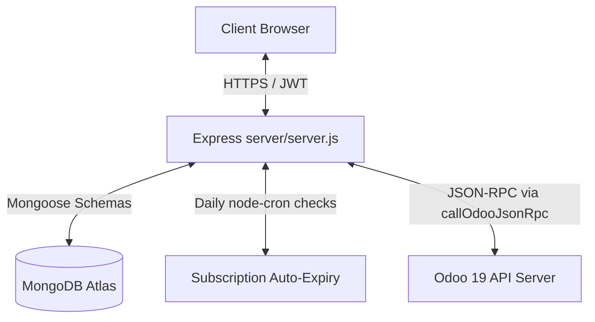

# 🌟 HRX System Documentation & Architecture Guide

Welcome to the comprehensive development and system documentation for the **HRX HR Management System**. This guide provides an in-depth reference to the application architecture, directory structure, system components, database schemas, REST APIs, and extensions guide.

---

## 🏛️ System Overview & Architecture

HRX is a modern, full-stack **Human Resources Management System** designed to manage multiple companies, subscription plans, employee records, payments, payroll, performance, attendance, and analytics. It is built as a highly responsive web application using the **MERN (MongoDB, Express, React, Node.js)** stack with **TypeScript** on the frontend for type-safe execution.

### Tech Stack Details:
- **Frontend Core**: React 18, TypeScript, TailwindCSS v4 with Vite compiler.
- **Frontend UI/UX**: Radix UI primitives, Motion (for smooth fluid micro-animations), Lucide React (icons), and custom theme states.
- **Backend Core**: Express.js (v5.x), Node.js, Mongoose.
- **Database**: MongoDB (Atlas cloud cluster).
- **Authentication**: Stateless JSON Web Tokens (JWT) with bcryptjs password hashing.
- **Cron Engine**: Automated daily check using node-cron.
- **External Integrations**: Odoo 19 JSON-RPC client integration.



---

## 📂 Codebase Folder Directory Walkthrough

Below is a walkthrough of the codebase directory structure:

```
HRX/
├── backend/                  # Core backend business logic & models
│   ├── config/               # Database connection config
│   │   └── db.js             # Connects to MongoDB & seeds the SuperAdmin
│   ├── controller/           # MVC Controllers mapping request logic
│   │   ├── adminController.js
│   │   ├── authController.js
│   │   ├── companyController.js
│   │   ├── paymentController.js
│   │   └── subscriptionController.js
│   ├── middelware/           # Legacy middleware folder (empty / migrated)
│   ├── middlewares/          # Express route middlewares
│   │   ├── auth.js           # JWT authentication validator
│   │   ├── errorHandler.js   # Centralized error handler
│   │   ├── roleMiddleware.js # Role-Based Access Control (RBAC)
│   │   └── validation.js     # Form validation executor
│   ├── Model/                # Mongoose Database Schemas
│   │   ├── activityLogModel.js
│   │   ├── companyModel.js
│   │   ├── paymentModel.js
│   │   ├── roleModel.js
│   │   ├── subscriptionModel.js
│   │   └── userModel.js
│   ├── utils/                # Helper utilities & background tasks
│   │   ├── cronJobs.js       # Daily subscription status checker
│   │   └── odooClient.js     # JSON-RPC integration wrapper for Odoo 19
│   └── validators/           # Yup input validation schemas
│       └── authValidators.js
├── routes/                   # REST API route handlers
│   ├── adminRoutes.js        # Protected SuperAdmin routes
│   ├── authRoutes.js         # Register, Login & Identity check routes
│   ├── companyRoutes.js      # Company admin settings routes
│   ├── goalRoutes.js         # Goals endpoints
│   ├── odooRoutes.js         # Integration routes fetching from Odoo
│   ├── paymentRoutes.js      # Billing and payment records routes
│   └── subscriptionRoutes.js # Plans and activations management routes
├── server/                   # Backend application entry point
│   ├── server.js             # Initializes Express and ports listening
│   └── package.json
├── src/                      # Vite Frontend Application
│   ├── app/                  # Application Logic and routing
│   │   ├── components/       # UI Pages and React Components
│   │   │   ├── ui/           # Radix primitive components
│   │   │   ├── Layout.tsx    # Sidebar Navigation Wrapper
│   │   │   ├── Login.tsx     # Authentication form component
│   │   │   ├── Register.tsx  # Setup portal component
│   │   │   ├── Dashboard.tsx # Main system layout
│   │   │   ├── SuperAdminDashboard.tsx # System operator layout
│   │   │   └── TimeOff.tsx   # Leave requests management UI
│   │   ├── services/         # API abstraction layers
│   │   │   ├── superAdminService.ts
│   │   │   └── odooConfig.ts
│   │   ├── types/            # TypeScript interfaces
│   │   │   └── superAdmin.types.ts
│   │   └── App.tsx           # Page router and authentication context state
│   ├── assets/               # Local static images
│   ├── styles/               # Stylesheets
│   └── main.tsx              # React mounting root
├── .env                      # Global environment configurations
├── package.json              # Client dependencies and execution scripts
└── vite.config.ts            # Vite compiler configuration
```

---

## 🚀 Setup & Local Installation

### Prerequisites
- **Node.js** (v18.x or above recommended)
- **MongoDB** (Atlas instance URL or local mongodb connection URI)

### Step 1: Install Dependencies
Run from the root directory to install client and compilation packages:
```bash
npm install
```
Then, install backend dependencies:
```bash
cd server
npm install
cd ..
```

### Step 2: Environment Variables
Create a file named `.env` in the root directory and define the following variables:
```ini
NODE_ENV=development
PORT=7500
MONGO_URL=your_mongodb_connection_uri

# Odoo 19 Configuration
ODOO_URL=http://localhost:8069
ODOO_DB=your-odoo-database-name
ODOO_USERNAME=your-username
ODOO_PASSWORD=your-password
```

### Step 3: Run the Application
Start the backend Express server:
```bash
cd server
npm start
```
Start the Vite development web client in another terminal:
```bash
# Return to root directory
npm run dev
```
Open [http://localhost:5173](http://localhost:5173) in your browser.

> [!NOTE]
> When the system boots up for the first time, it automatically seeds a default Super Admin account if it does not exist:
> - **Email**: `admin@gmail.com`
> - **Password**: `123456`
> - **Role**: `superadmin`

---

## 🔐 Authentication & Security

### Stateless JWT Implementation
Token verification is handled by the middleware [auth.js](file:///d:/HRX/HRX/backend/middlewares/auth.js). 
Authentication details:
1. Passwords are encrypted in the database using **bcryptjs** (10 salt rounds).
2. The endpoint `POST /api/auth/login` generates a JSON Web Token containing the user ID.
3. The token is stored on the client side (`localStorage`) and sent in the HTTP `Authorization` header as `Bearer <token>`.

### Role-Based Access Control (RBAC)
User access control is enforced via [roleMiddleware.js](file:///d:/HRX/HRX/backend/middlewares/roleMiddleware.js). Endpoints specify who can access them:
```javascript
// Example: Protect route and restrict access to superadmins only
router.use(protect, allowRoles('superadmin'));
```

---

## 🎯 Key Features Deep Dive

### 1. Super Admin Portal
Enables centralized system operations. Built inside [SuperAdminDashboard.tsx](file:///d:/HRX/HRX/src/app/components/SuperAdminDashboard.tsx), it supports:
- **KPI Metrics Overview**: Visual cards reporting Total Companies, Active, Pending, and Expired status.
- **CRUD Operations**: Manage subscriber details, select subscription levels (Basic, Professional, Enterprise), and set employee capacity.
- **Quick Controls**: Instant toggles to Activate or Suspend companies, triggering status propagation rules to the MongoDB database.

### 2. Localization (i18n) & Dark Mode
- **Dual-Language**: Supports English and Arabic. Translation mappings are stored in [superAdmin.types.ts](file:///d:/HRX/HRX/src/app/types/superAdmin.types.ts#L30-L200) under the `UI_LABELS` variable. The system respects text directionality (RTL) for Arabic.
- **Dark Theme**: Enabled via a toggle button, applying dark CSS styles to visual boundaries and persisting preferences inside `localStorage`.

### 3. Automated Cron Engine
The file [cronJobs.js](file:///d:/HRX/HRX/backend/utils/cronJobs.js) runs a background worker scheduled to check for expired subscriptions daily at midnight (`0 0 * * *`).
- Queries MongoDB for active subscriptions where `endDate` is prior to the current system time.
- Modifies subscription status to `Expired`.
- Automatically suspends the associated company profile.

### 4. Odoo 19 JSON-RPC Link
Directly connects to an Odoo ERP workspace database via JSON-RPC. The client [odooClient.js](file:///d:/HRX/HRX/backend/utils/odooClient.js) automatically cycles through `/jsonrpc` and `/web/jsonrpc` endpoints to authenticate using Odoo's service endpoints. It downloads company listings (`res.partner`) where `is_company` is set to `true`.

---

## 🌐 API Endpoint Reference

All main API endpoints are listed below:

### Authentication (`/api/auth`)
| Method | Route | Description | Auth Required | Role |
| :--- | :--- | :--- | :--- | :--- |
| **POST** | `/signUp` | Register a new company account and admin | No | Public |
| **POST** | `/login` | Log in as admin or superadmin to receive JWT token | No | Public |
| **GET** | `/me` | Get the profile details of the currently authenticated user | Yes | Any |

### Super Admin Operations (`/api/admin`)
| Method | Route | Description | Auth Required | Role |
| :--- | :--- | :--- | :--- | :--- |
| **GET** | `/dashboard` | Retrieve statistics (Company statuses, metrics) | Yes | `superadmin` |
| **GET** | `/companies` | Query registered company list with search and filters | Yes | `superadmin` |
| **GET** | `/companies/:id` | Fetch specific company information | Yes | `superadmin` |
| **POST** | `/companies` | Add a new client company database profile | Yes | `superadmin` |
| **PUT** | `/companies/:id` | Edit details of an existing client company | Yes | `superadmin` |
| **DELETE** | `/companies/:id` | Permanently remove a company from the system | Yes | `superadmin` |
| **POST** | `/companies/:id/activate` | Explicitly change company status to Active | Yes | `superadmin` |
| **POST** | `/companies/:id/suspend` | Explicitly change company status to Suspended | Yes | `superadmin` |

### Billing and Payments (`/api/payments`)
| Method | Route | Description | Auth Required | Role |
| :--- | :--- | :--- | :--- | :--- |
| **POST** | `/` | Log a payment transaction record | Yes | `company_admin`, `superadmin` |
| **GET** | `/company/:companyId` | Retrieve payment receipts for a company | Yes | `company_admin`, `superadmin` |
| **GET** | `/:id` | Get individual payment item details | Yes | `company_admin`, `superadmin` |
| **PUT** | `/:id` | Change status of payment (Paid, Failed, Pending) | Yes | `company_admin`, `superadmin` |

### Subscription Plans (`/api/subscriptions`)
| Method | Route | Description | Auth Required | Role |
| :--- | :--- | :--- | :--- | :--- |
| **POST** | `/` | Create a new subscription record | Yes | `company_admin`, `superadmin` |
| **GET** | `/company/:companyId` | Fetch current company subscription details | Yes | `company_admin`, `superadmin` |
| **PUT** | `/:id` | Modify subscription details | Yes | `company_admin`, `superadmin` |
| **POST** | `/:id/activate` | Mark subscription state as Active | Yes | `company_admin`, `superadmin` |
| **POST** | `/:id/cancel` | Terminate and cancel subscription | Yes | `company_admin`, `superadmin` |

### Odoo ERP Integration (`/odoo`)
| Method | Route | Description | Auth Required | Role |
| :--- | :--- | :--- | :--- | :--- |
| **GET** | `/companies` | Fetch partner directory index from Odoo 19 | No | Public |
| **GET** | `/companies/:id` | Fetch single Odoo company profile details by Odoo ID | No | Public |

---

## 🛠️ Developer Extension Guide

This section explains how to extend HRX features.

### A. How to Add a New API Endpoint
1. **Define Schema Field (Optional)**: If the new feature requires a database schema change, add it in the appropriate model file in [Model/](file:///d:/HRX/HRX/backend/Model/).
2. **Implement Controller Logic**: Add a handler function in the relevant controller (e.g. [companyController.js](file:///d:/HRX/HRX/backend/controller/companyController.js)). Ensure you handle errors gracefully.
3. **Register Backend Route**: Connect the controller action to an HTTP path in the matching route file in [routes/](file:///d:/HRX/HRX/routes/) (e.g. `companyRoutes.js`).
4. **Create Frontend Service**: Map the new API path in a service helper class (e.g., [superAdminService.ts](file:///d:/HRX/HRX/src/app/services/superAdminService.ts)).
5. **Update Component UI**: Invoke the service call in your component page, handling loading states and displaying notifications via standard UI alerts.

### B. How to Add a New Interface Language
1. Open the file [superAdmin.types.ts](file:///d:/HRX/HRX/src/app/types/superAdmin.types.ts).
2. Locate the `UI_LABELS` variable definition.
3. Add a new property containing translation keys mapping to the label values. For example, for German (`de`):
```typescript
export const UI_LABELS = {
  en: {
    dashboard: "Dashboard",
    companies: "Companies",
    // English translation...
  },
  ar: {
    dashboard: "لوحة التحكم",
    companies: "الشركات",
    // Arabic translation...
  },
  de: {
    dashboard: "Dashboard",
    companies: "Unternehmen",
    // German translation...
  }
};
```
4. Update language toggle options dropdown list in [SuperAdminDashboard.tsx](file:///d:/HRX/HRX/src/app/components/SuperAdminDashboard.tsx).
